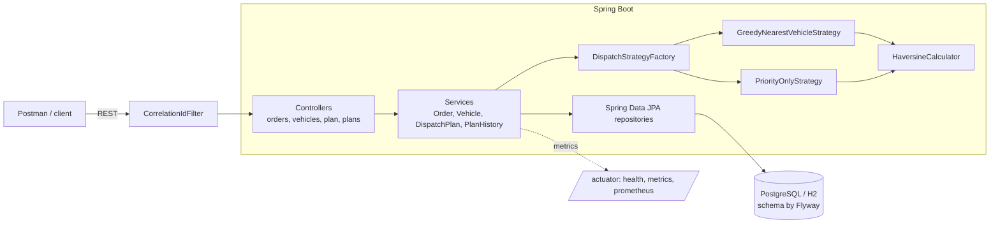

# Dispatch Load Balancer

A Spring Boot 3 / Java 17 service that assigns delivery orders to a vehicle fleet, honouring **priority** and
**capacity** while keeping **travel distance** low (Haversine). Orders and fleet are stored in PostgreSQL, every
computed plan can be saved, and the service ships with health checks, metrics, CI and container support.

## Live demo

| | Link |
|---|---|
| Live application | `https://dispatch-load-balancer-q6wh.onrender.com`|
| Swagger UI (interactive API docs) | `https://dispatch-load-balancer-q6wh.onrender.com/swagger-ui/index.html` |
| OpenAPI spec | `https://dispatch-load-balancer-q6wh.onrender.com/v3/api-docs` (also saved as `docs/openapi.json`) |
| Health check | `https://dispatch-load-balancer-q6wh.onrender.com/actuator/health` |
| Video walkthrough (Loom) | `"D:\new-assesment\Recording 2026-11-20 211522.mp4"` |

> The free hosting tier sleeps after about 15 minutes without traffic, so the first request can take up to a minute.
> The sample data (30 orders, 5 vehicles) is loaded automatically on start-up.

## Architecture



Layering: `controller -> service -> strategy | repository`. Controllers only translate HTTP; services hold the rules;
strategies are pure (no I/O) so they are trivially unit-testable.

## Quick start

```bash
# 1. In-memory H2, zero setup
mvn spring-boot:run

# 2. App + PostgreSQL with Docker Compose
docker compose up --build

# 3. Local app against the Compose database only
docker compose up -d postgres
mvn spring-boot:run -Dspring-boot.run.profiles=postgres
```

| What | Where |
|---|---|
| Swagger UI | http://localhost:8080/swagger-ui.html |
| Health | http://localhost:8080/actuator/health |
| Metrics / Prometheus | `/actuator/metrics`, `/actuator/prometheus` |
| H2 console (H2 mode) | http://localhost:8080/h2-console (`jdbc:h2:mem:dispatchdb`, user `sa`) |
| Postman collection | `postman/dispatch-load-balancer.postman_collection.json` |
| Sample data | `docs/sample-orders.json`, `docs/sample-vehicles.json` |

Try it: import the Postman collection and run folder **1. Setup**, then **2. Plans**.

## API

Every endpoint is available under **`/api/v1/dispatch`** and, unchanged, under the assignment's original
**`/api/dispatch`** prefix.

### Required by the assignment
| Method | Path | Description |
|---|---|---|
| POST | `/orders` | Submit delivery orders (upsert by `orderId`) |
| POST | `/vehicles` | Submit fleet details (upsert by `vehicleId`) |
| GET | `/plan` | Compute the dispatch plan (`?strategy=` optional, not saved) |

### Orders and vehicles
| Method | Path | Description |
|---|---|---|
| GET | `/orders` | Search: `priority`, `minWeight`, `maxWeight`, `q` (address text), `page`, `size`, `sort` |
| GET / PUT / PATCH / DELETE | `/orders/{orderId}` | Read, replace, partially update, delete |
| GET | `/vehicles` | Search: `minCapacity`, `maxCapacity`, `q`, `page`, `size`, `sort` |
| GET / PUT / PATCH / DELETE | `/vehicles/{vehicleId}` | Read, replace, partially update, delete |

Example: `GET /api/v1/dispatch/orders?priority=HIGH&minWeight=10&sort=packageWeight,desc&page=0&size=20`

### Plans, strategies, admin
| Method | Path | Description |
|---|---|---|
| POST | `/plans` | Generate **and save** a plan (`?strategy=`); 201 + `Location` |
| GET | `/plans` | Saved plans, paged (newest first by default) |
| GET | `/plans/{planId}` | One saved plan with all assignments |
| GET | `/plans/{planId}/summary` | KPIs: assignment rate, fleet utilization, distance, idle vehicles, per-vehicle stats |
| DELETE | `/plans/{planId}` | Delete a saved plan |
| GET | `/strategies` | Available algorithms |
| DELETE | `/reset` | Clear orders and vehicles (`?includePlans=true` also clears plan history) |

### Status codes and errors
`200` ok, `201` plan created, `204` deleted, `400` validation/malformed input/unknown strategy or sort field,
`404` unknown id or path, `405` wrong method, `422` plan requested with no orders or no vehicles, `500` unexpected.

```json
{ "status": "error", "message": "Validation failed",
  "errors": ["orders[0].latitude: latitude must be <= 90"],
  "correlationId": "5f1c...", "timestamp": "2026-11-20T10:15:30Z" }
```

### Plan response
```json
{
  "dispatchPlan": [
    { "vehicleId": "VEH001", "capacity": 100.0, "totalLoad": 95.0,
      "totalDistance": "12.34 km", "totalDistanceKm": 12.34,
      "assignedOrders": [ { "orderId": "ORD007", "latitude": 28.7041, "longitude": 77.1025,
                            "address": "Karol Bagh, Delhi, India", "packageWeight": 20.0, "priority": "HIGH" } ] }
  ],
  "unassignedOrders": [
    { "order": { "orderId": "ORD006", "...": "..." }, "reason": "No vehicle has enough remaining capacity" }
  ]
}
```
`assignedOrders` is in delivery order. A saved plan is a **snapshot**: later edits to orders or vehicles never change it.

## Algorithms

| Strategy | Behaviour |
|---|---|
| `greedy` (default) | Orders sorted HIGH to LOW (then heavier first); each goes to the nearest vehicle (from its last stop) with spare capacity; each route is then shortened with 2-opt. |
| `priority-only` | Same priority order, but the vehicle with the most spare capacity wins and distance is ignored. A baseline to compare against. |

Orders that cannot be placed are returned in `unassignedOrders` with a reason. Capacitated vehicle routing is NP-hard, so
`greedy` is a fast heuristic, not a proven optimum. Distance is an open route from the vehicle's start through each stop
(no return leg). Add a strategy by implementing `DispatchStrategy` as a Spring bean; it appears in `/strategies` automatically.

## Design decisions

- **Strategy + Factory patterns** for algorithms; **Mapper** layer between entities and DTOs; **Specifications** for filtering.
- **Flyway owns the schema** (`ddl-auto: none`); the same migrations run on H2 and PostgreSQL.
- **Upserts** on submit (`saveAll` by id), duplicate ids inside one request are rejected up front.
- **Validation** with Bean Validation (coordinate ranges, positive weights, id format, lengths) and one `@RestControllerAdvice`
  producing a uniform error body. Sort fields are whitelisted so bad `sort=` values return 400, not 500.
- **Plans store summary columns plus a JSON snapshot** so history can be paged and sorted in SQL and stays immutable.
- **API versioning** by path prefix, keeping the assignment's URLs working.

## Observability

- `X-Correlation-Id` header is accepted (if safe) or generated, echoed back, put in every log line (`[cid=...]`),
  and included in error bodies. One `key=value` access line is logged per request.
- Micrometer metrics: `dispatch.plan.duration` (timer, tagged by strategy), `dispatch.plans.generated`,
  `dispatch.orders.unassigned`, plus the standard JVM/HTTP metrics. Prometheus format at `/actuator/prometheus`.
- Health with liveness/readiness probes; the Docker image has a `HEALTHCHECK` and runs as a non-root user.

## Deployment (Render, Docker)

The app is containerised (`Dockerfile`) and ships a Render blueprint (`render.yaml`).

1. Push the repository to GitHub.
2. In Render: **New > Blueprint**, pick the repository (or **New > Web Service** with runtime **Docker** and the Free instance type).
3. Make sure the environment variable `SPRING_PROFILES_ACTIVE=prod` is set. The `prod` profile turns off the H2 console and
   loads the sample data at start-up (the in-memory database is empty after every restart).
4. After the build finishes, open `/swagger-ui.html` and `/actuator/health` on the generated URL.

Notes: the app reads `PORT` from the platform and honours `X-Forwarded-*` headers, so Swagger's "Try it out" uses https.
For persistent data, point it at a hosted PostgreSQL instead: set `SPRING_PROFILES_ACTIVE=prod,postgres`, `DB_URL`
(`jdbc:postgresql://HOST:5432/DB?sslmode=require`), `DB_USER` and `DB_PASSWORD`. Flyway creates the schema on first start.

## Testing

```bash
mvn test        # unit + MockMvc integration tests (H2)
mvn verify      # same, plus the JaCoCo report at target/site/jacoco/index.html
```

- Unit tests: Haversine, both strategies, strategy factory, statistics calculator, validators.
- Integration tests: full REST flow, paging/filtering/PUT/PATCH, plan history, correlation ids, actuator, error handling.
- `PostgresIntegrationTest` uses Testcontainers against real PostgreSQL and is skipped automatically when Docker is unavailable.
- GitHub Actions (`.github/workflows/ci.yml`) runs `mvn verify`, uploads the coverage report and builds the Docker image.

## Project layout

```
src/main/java/com/dispatch/loadbalancer
  config/        CorrelationIdFilter, OpenApiConfig
  controller/    OrderController, VehicleController, DispatchPlanController, PlanHistoryController
  service/       OrderService, VehicleService, DispatchPlanService, PlanHistoryService,
                 PlanStatisticsCalculator, DataResetService
  strategy/      DispatchStrategy, GreedyNearestVehicleStrategy, PriorityOnlyStrategy, DispatchStrategyFactory
  repository/    JPA repositories + Specifications
  model/         DeliveryOrder, Vehicle, StoredDispatchPlan, Priority
  dto/           request/ and response/ records
  mapper/        DispatchMapper
  exception/     domain exceptions + GlobalExceptionHandler
  util/          HaversineCalculator, RequestValidator, SortValidator
src/main/resources  application.yml, application-postgres.yml, db/migration/V1, V2
src/test/java       unit and integration tests
```

## Assumptions and limits

- Weights and capacities share one unit. The 30 sample orders weigh 645 against a fleet capacity of 500, so some are always unassigned.
- Priority beats distance: a HIGH order is placed before any MEDIUM or LOW one.
- 2-opt is skipped for routes longer than 200 stops to keep planning fast.

## Future work

Spring Security with JWT and roles, response caching for repeated plans, asynchronous planning for very large batches
(queue + job id), return-to-depot routing, and an optimal solver (OR-Tools) as another `DispatchStrategy`.
